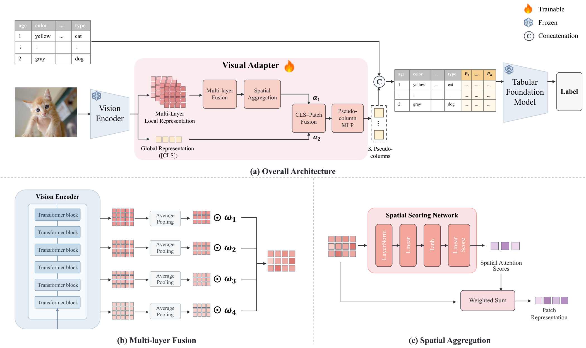

# ViTab-Adapter

Anonymous review repository for **ViTab-Adapter: Lightweight Visual Adaptation
for Tabular Foundation Models**. ViTab-Adapter maps frozen visual features to
a small set of pseudo-columns and appends them to the original table for
prediction with a frozen tabular foundation model.

## Overview



## Quickstart

### 1. Download

Download the source from **Code → Download ZIP** and extract it. Run the commands below from the extracted repository root.

### 2. Set up the environment

Use Python 3.11 and a CUDA-enabled PyTorch installation.

Install the CUDA 12.4 builds of PyTorch 2.5.1 and torchvision 0.20.1, then run
`python -m pip install -r requirements.txt`. Provide a local Hugging Face
snapshot of `openai/clip-vit-large-patch14` and the task-appropriate checkpoint
from `jingang/TabICL`: `tabicl-classifier-v2-20260212.ckpt` or
`tabicl-regressor-v2-20260212.ckpt`. Keep the model snapshots unchanged across runs.

### 3. Prepare the data

Obtain the datasets from their official sources and follow the applicable
access terms. For VT-Bench, supply the benchmark's preprocessed feature
exports at `DATA_BASE/vt/<legacy_name>/features`. For MulTaBench, supply the
downloaded dataset exports at `DATA_BASE/multabench/_downloads/<slug>`, with
`data.csv`, `metadata.json` and the referenced images. The metadata identifies
the image and target columns via `image_col` and `target`. Supported dataset
IDs and slugs are listed in the preparation script and registry.

```sh
python -m vitab_adapter.prepare --data-base DATA_BASE --output prepared
```

The preparation command also accepts repeated `--dataset` flags. It copies
the existing VT-Bench split and uses the TabSTAR 1.1.15 split implementation
for the aligned MulTaBench folds. All three seeds use VT-Bench fold 0.
For MulTaBench, seeds 42, 43 and 44 use folds 0, 1 and 2, respectively. For exact reproduction, supply
the same source dataset snapshots and filtering used by the experiments.

The runner consumes `prepared/<dataset>/fold_<n>/metadata.json` and
`train.npz`, `val.npz`, `test.npz`. Each NPZ contains `x`, `y` and
`image_paths` in matching row order. Relative paths are resolved against
`image_base_dir` in metadata. Prepared files may reference local licensed
images and should stay outside the review repository.

### 4. Train and evaluate

```sh
python -m vitab_adapter run --dataset vt_skin_cancer --seed 42 --prepared prepared --output runs --clip-model weights/clip --tabicl-checkpoint weights/tabicl-classifier-v2-20260212.ckpt
python -m vitab_adapter summarize --output runs --csv summary.csv
```

- **Seeds** · Run 42, 43, and 44.
- **Model selection** · Sweep K = 4, 8, 16, 32, 64, 128. Select by validation accuracy or RMSE, breaking ties toward smaller K. Test the selected checkpoint.
- **Reporting** · Aggregate test scores as mean ± sample standard deviation over three seeds.
- **Training** · 50 epochs maximum, patience 15, and 2,500 rows per training block. Train/validation/test ensemble sizes are 2/2/8.
- **Reruns** · Completed candidates and frozen features are reused. Use a new output directory if images or weights change in place.

## Ablations and encoder replacements

Add the following options to the training command above. Use the same
prepared split and TabICLv2 checkpoint for the comparisons.

| Setting | Options | Protocol |
| --- | --- | --- |
| 64 patches (default) | `--variant E3` (default) | Standard configuration with 64 patches per layer. |
| 1 or 16 patches | `--variant E1` or `--variant E2` | Pool the projected 8×8 patch grid to 1 or 16 tokens per layer. |
| 256 patches | `--variant E4` | Use the original 256 patches per layer. Add `--train-block 1250` for the smaller-block runs. |
| DINOv2 | `--vision dinov2 --clip-model weights/dinov2` | Use the local snapshot of `facebook/dinov2-large`. |
| OpenCLIP | `--vision openclip --clip-model weights/openclip` | Use the local Transformers snapshot of `laion/CLIP-ViT-L-14-laion2B-s32B-b82K`. |
| Test-time modality ablation | `--modality-ablation` | Reuse the selected standard CLIP + TabICLv2 checkpoint. Replace the corresponding input columns with per-estimator training-context means before TabICLv2, preserving feature order and width. |

The standard run writes into `runs`. Other configurations write into
`runs/<variant-or-encoder>`. Summarize each configuration using its own
output root. For modality ablation, run
`python -m vitab_adapter summarize --output runs --kind modality --csv modality.csv`.

## Tabular backend replacements

Install the compatible optional backend in its own environment with the
base requirements. For TabPFN use the v3.5-capable TabPFN 8.2.0 runtime and
the v3.5 checkpoint. For TabFM install the official Google Research TabFM
PyTorch source exposing `tabfm.src.pytorch.tabfm_v1_0_0.load` and use the
local TabFM v1.0.0 checkpoint directory containing its config and weights.

```sh
python -m vitab_adapter run --dataset vt_skin_cancer --seed 42 --prepared prepared --output runs --clip-model weights/clip --backend tabpfn35 --backend-weights weights/tabpfn-v3.5-20260909.safetensors
python -m vitab_adapter run --dataset vt_skin_cancer --seed 42 --prepared prepared --output runs --clip-model weights/clip --backend tabfm --backend-weights weights/tabfm
python -m vitab_adapter summarize --output runs/tabfm --csv tabfm.csv
```

The replacement workflow preserves the backend-specific experimental
settings. TabPFN v3.5 uses 2,500 rows per training block and 512 query rows
per evaluation chunk. TabFM uses 1,250 rows per training block, 64 query
rows per evaluation chunk, and activation checkpointing for its attention
blocks. Both freeze the predictor, select K on validation, and evaluate
the selected multimodal adapter alongside a paired table-only prediction
on the same test split. The summary includes the paired gain, defined as
multimodal minus table-only ACC or table-only minus multimodal RMSE.

## Results

ViTab-Adapter with CLIP and TabICLv2 on the 14 datasets in the aligned three-seed evaluation. Values are test mean ± sample standard deviation.

### Classification · Accuracy (%) ↑

| Dataset | ViTab-Adapter |
| --- | ---: |
| Skin Cancer | 86.96 ± 0.00 |
| Breast Cancer | 53.95 ± 1.79 |
| Infarction | 71.44 ± 0.31 |
| Mammography CMMD | 80.72 ± 1.77 |
| Hateful Meme | 76.20 ± 1.85 |
| Justin Instagram | 95.92 ± 1.09 |
| Glaucoma SMDG | 89.09 ± 0.68 |
| Adoption | 47.04 ± 0.75 |
| CheXpert | 70.32 ± 0.62 |

### Regression · RMSE ↓

| Dataset | ViTab-Adapter |
| --- | ---: |
| Mango Mass | 0.0344 ± 0.0020 |
| Amazon Bestseller | 0.5721 ± 0.0091 |
| Pawpularity | 17.2254 ± 0.0236 |
| MkPhoto Bots | 0.0918 ± 0.0035 |
| Anime | 0.4213 ± 0.0048 |

## Outputs and data access

The run directory contains per-candidate validation metrics, selected test
metrics, and local feature caches and checkpoints. Download datasets and model
weights from their upstream providers under their access terms. The review
repository includes source code, documentation, and aggregate scores. Keep dataset files,
checkpoints, caches, logs, and credentials outside Git.

## Third-party code and attribution

The benchmark loading and preprocessing helpers under `mmpfn` are
adapted from MultiModalPFN. The accompanying third-party license is
included in [LICENSE-MultiModalPFN](LICENSE-MultiModalPFN).

Built with PriorLabs-TabPFN (attribution for the reused benchmark helpers).
